# 🚀 Awesome API Client & Design Platform

  

  
  
  
  
  
  

---

## ⚡ Top API Client & Design Platform Ecosystem

> 🌐 **Curated List of SaaS / Hosted Platforms & Open-Source Developer Tools**  
> 🎯 *Focused on REST / GraphQL / gRPC Testing Clients, OpenAPI Design, Git-Friendly Collections, Mock Servers & Self-Hosted Workspaces*  
> 📅 **Last updated: November 2026**

This repository is an SEO-optimized developer guide and curated directory tracking top **SaaS platforms** and **open-source GitHub repositories** for **API Clients, OpenAPI Specification Design, Contract Testing, and API Mocking**. Whether you are debugging microservices, replacing Postman with local Git-versioned `.bru` or `.http` files, or establishing enterprise OpenAPI governance style guides, find the best fit here.

---

## 📑 Table of Contents

- [📊 Sector Overview & Market Dynamics](#-sector-overview--market-dynamics)
- [☁️ SaaS / Hosted Platforms](#️-saas--hosted-platforms)
- [🔓 Open-Source GitHub Projects](#-open-source-github-projects)
  - [⭐ Featured Open-Source Projects (Ranked by Stars)](#-featured-open-source-projects-ranked-by-stars)
  - [🛠️ Additional Open-Source API Tools & CLI Clients](#️-additional-open-source-api-tools--cli-clients)
- [🧩 Architecting Custom API Toolchains](#-architecting-custom-api-toolchains)
- [🤝 How to Contribute](#-how-to-contribute)
- [💖 Support & Sponsorship](#-support--sponsorship)
- [📈 Star History](#-star-history)
- [⚖️ Disclaimer](#️-disclaimer)

---

## 📊 Sector Overview & Market Dynamics

The global API management and developer client sector represents an estimated market size of approximately **$8.8B – $10.5B**, compounding rapidly at **~16%–17% CAGR** toward over **$30B+** by the mid-2030s. 

The market exhibits a distinct dual dynamic:
* **Enterprise Infrastructure Tier (Moderately Concentrated):** Large enterprise deployments and gateway control planes are dominated by a handful of hyperscalers and incumbents (such as Google Apigee, AWS API Gateway, Microsoft Azure, Kong, and MuleSoft).
* **Developer Client & Design Tier (Highly Fragmented):** Desktop API clients, OpenAPI editors, local mock servers, and testing runners remain intensely fragmented. Growing enterprise privacy requirements, cloud data governance regulations, and developer resistance against forced cloud synchronization have sparked explosive adoption of local-first, Git-versioned, and self-hostable open-source alternatives.

---

## ☁️ SaaS / Hosted Platforms

Below are the premier hosted and cloud-synced API development suites, sorted in descending order by company valuation / revenue scale:

| Platform | Valuation / Revenue | Starting Pricing Tier | Free Tier Limits | Description |
| :--- | :--- | :--- | :--- | :--- |
| **[Postman](https://postman.com)** | Valuation: ~$5.6B (Series D)   Revenue: ~$300M+ ARR | $9/user/month (Solo) billed annually; $19/user/month (Team) | Strictly limited to 1 user seat, max 5 integrations, and up to 10,000 Postman API calls/month (multi-user collaboration removed from free plan). | Industry-standard collaborative API platform for designing, testing, mocking, documenting, and monitoring REST, GraphQL, and gRPC APIs. |
| **[Insomnia (Kong Hosted Cloud)](https://insomnia.rest)** | Valuation: $2.0B (Kong Series E)   Revenue: Kong >$100M ARR | $10/user/month (Pro, billed annually) or $12/user/month (monthly) | Free forever for individuals/unlimited collection runs; Git sync capped at up to 3 users per team; mock server capped at 1,000 requests/month. | Commercial cloud-synced tier of Kong's API client supporting team workspaces, E2EE vault storage, and enterprise RBAC. |
| **[RapidAPI & Paw](https://rapidapi.com)** | Valuation: Peak $1.0B (Series D, acquired by Nokia for ~$106M) | Paid marketplace plans start at $10/month; native client is 100% free | RapidAPI for Mac (formerly Paw) is 100% free with no request caps. RapidAPI Hub marketplace free tier enforces basic limits (e.g. typically 1,000 calls/hr or 100–10,000 calls/mo depending on provider). | Global API marketplace and native macOS HTTP/REST client for discovering, testing, and managing third-party and internal APIs. |
| **[SwaggerHub (SmartBear)](https://swagger.io)** | Valuation: PE-backed (SmartBear EV >$1B)   Revenue: SmartBear ~$250M ARR | $19/user/month (Individual, billed annually); $29/user/month (Team) | No permanent free tier. Offers a 14-day free trial on Team tier with full access to visual editor, mocking, and contract testing (50 test executions). | Cloud-based OpenAPI and AsyncAPI design, governance, and documentation platform for enterprise API lifecycle management. |
| **[Stoplight](https://stoplight.io)** | Valuation: Acquired by SmartBear (SmartBear EV >$1B) | $44/month (Basic, billed annually; includes 3 seats) | Free forever plan strictly capped at 1 user and 1 project; includes visual designer and mock servers with no request quotas. | Collaborative API design-first platform offering visual OpenAPI modeling, style guide linting, instant mock servers, and hosted developer portals. |
| **[Thunder Client](https://thunderclient.com)** | Revenue: Privately held / Bootstrapped (Unfunded micro-SaaS) | $3/user/month (Starter, billed annually); $7/user/month (Business) | Free for non-commercial/individual use; capped at 10 collections and 50 requests per collection; excludes Git sync and CLI integrations. | Lightweight GUI REST API client extension built natively inside Visual Studio Code for quick request testing and local Git storage. |
| **[Apidog](https://apidog.com)** | Revenue: Privately held / Bootstrapped (Unfunded) | $9/user/month (Basic, billed annually); $18/user/month (Professional) | Free forever plan supports up to 4 team members, up to 5 projects, and 1 sprint branch per project; unlimited request/mock volume. | All-in-one collaborative API development workspace combining visual OpenAPI specification design, automated testing, smart mock servers, and live documentation. |

---

## 🔓 Open-Source GitHub Projects

Discover the best open-source alternatives for API development, testing, spec design, and mock servers. 

### ⭐ Featured Open-Source Projects (Ranked by Stars)

Sorted in descending order by GitHub Stars_Count:

1. **[Hoppscotch](https://github.com/hoppscotch/hoppscotch)**   
   *Open-Source API Development Ecosystem* — Lightweight, blazing-fast web, desktop, and CLI API client supporting REST, GraphQL, WebSocket, SSE, Socket.IO, and MQTT with self-hosting options.

2. **[Bruno](https://github.com/usebruno/bruno)**   
   *Offline-First, Git-Native Desktop API Client* — Fast, open-source Postman alternative that stores collections directly in plain text `.bru` format on your filesystem, allowing versioning via standard Git branches and pull requests.

3. **[Insomnia Open-Source Core (Kong)](https://github.com/Kong/insomnia)**   
   *Cross-Platform API Client & Design Studio* — Open-source desktop client for REST, GraphQL, gRPC, and WebSockets featuring local workspaces, plugin extensibility, and OpenAPI linting/generation.

4. **[HTTPie CLI](https://github.com/httpie/cli)**   
   *Modern User-Friendly Terminal HTTP Client* — Designed for human interaction with intuitive syntax, colored JSON terminal output, persistent sessions, and custom plugin ecosystems.

5. **[Swagger UI](https://github.com/swagger-api/swagger-ui)**   
   *Interactive OpenAPI Visualization* — Industry-standard web component collection that renders visual, interactive OpenAPI 3.x and Swagger documentation directly in the browser.

6. **[OpenAPI Generator](https://github.com/OpenAPITools/openapi-generator)**   
   *Multi-Language API Client & Server Stub Generator* — Generates client SDKs, server stubs, and API documentation across 50+ programming languages directly from OpenAPI specs.

7. **[Redoc](https://github.com/Redocly/redoc)**   
   *Responsive OpenAPI API Documentation* — Clean, customizable three-panel API reference documentation generator supporting OpenAPI 3.0 and 3.1 definitions.

8. **[Yaak](https://github.com/mountain-loop/yaak)**   
   *Tauri & Rust Powered Native API Client* — Ultra-fast, lightweight desktop API client for REST, GraphQL, gRPC, WebSockets, and Server-Sent Events (SSE) with no mandatory cloud account.

9. **[Hurl](https://github.com/Orange-OpenSource/hurl)**   
   *Plain-Text HTTP Request Runner & Testing Engine* — High-performance Rust CLI for defining, running, and asserting complex HTTP requests and integration test flows in plain-text files.

10. **[Scalar](https://github.com/scalar/scalar)**   
    *Modern API Platform & Interactive Docs* — Open-source OpenAPI client and interactive documentation generator designed for modern developer portals and interactive testing.

11. **[Posting](https://github.com/darrenburns/posting)**   
    *Terminal User Interface (TUI) API Client* — Keyboard-driven, Python Textual-powered API testing tool that lives completely in your terminal and stores requests in local YAML configurations.

12. **[Swagger Editor](https://github.com/swagger-api/swagger-editor)**   
    *Browser-Based OpenAPI Spec Editor* — Visual editor for designing, describing, and documenting APIs using the OpenAPI Specification with real-time linting and preview.

13. **[Mockoon](https://github.com/mockoon/mockoon)**   
    *Zero-Configuration Local API Mocking* — Desktop and CLI mock server utility to create realistic mock REST and GraphQL APIs locally without cloud accounts or external infrastructure.

14. **[WireMock](https://github.com/wiremock/wiremock)**   
    *Enterprise HTTP Mocking & Service Virtualization* — Flexible tool for mocking HTTP services, simulating unstable networks, verifying API interactions, and unit/integration testing.

15. **[REST Client for VS Code](https://github.com/Huachao/vscode-restclient)**   
    *In-Editor HTTP Execution* — Execute raw HTTP requests directly within Visual Studio Code `.http` or `.rest` files and inspect responses without leaving your editor.

16. **[Prism (Stoplight)](https://github.com/stoplightio/prism)**   
    *OpenAPI-Driven Mock & Validation Proxy* — Turn OpenAPI v2/v3 documents into responsive mock servers with automatic contract validation and dynamic synthetic payload generation.

17. **[Spectral (Stoplight)](https://github.com/stoplightio/spectral)**   
    *Pluggable JSON/YAML Linter & Style Guide Engine* — Automated linter for enforcing OpenAPI, AsyncAPI, and JSON Schema conventions across engineering organizations in CI/CD pipelines.

18. **[Firecamp](https://github.com/firecamp-dev/firecamp)**   
    *Developer-First Open-Source API DevTool* — Multi-protocol API platform supporting REST, GraphQL, WebSocket, and Socket.IO with Git-centric team collaboration.

19. **[Stoplight Elements](https://github.com/stoplightio/elements)**   
    *Embeddable Interactive API Docs* — Build beautiful, interactive API documentation powered by OpenAPI and Markdown using embeddable React and Web Components.

20. **[Step CI](https://github.com/stepci/stepci)**   
    *Automated API Testing & Quality Assurance* — Open-source framework for contract testing, load testing, and end-to-end API workflows configured through straightforward YAML files.

---

### 🛠️ Additional Open-Source API Tools & CLI Clients

* **[Insomnium](https://github.com/ArchGPT/insomnium)**  — Privacy-focused, 100% offline fork of Insomnia engineered without cloud synchronization or mandatory logins.
* **[Postwoman / Hoppscotch CLI](https://github.com/hoppscotch/hoppscotch)** — Command-line companion to Hoppscotch for executing and asserting collections in continuous integration pipelines.
* **[openapi-diff](https://github.com/OpenAPITools/openapi-diff)** — Utility for comparing OpenAPI specifications and detecting breaking API changes before deployments.

---

## 🧩 Architecting Custom API Toolchains

Engineering teams frequently compose modular, open-source toolchains rather than adopting a single vendor lock-in product:
* 📁 **Request Collections & Team Testing:** Use **Bruno** or **Yaak** to store requests as plain files in Git repositories.
* 📐 **Specification & Design-First Modeling:** Use **Swagger Editor** or **Scalar** to draft and visualize OpenAPI definitions.
* 🛡️ **Governance & Linting:** Run **Spectral** in Git pre-commit hooks and GitHub Actions to enforce company API design style guides.
* 🎭 **Contract Mocking:** Spin up **Prism** or **Mockoon** in local development environments and QA pipelines to simulate unreleased microservices.
* 🧪 **CI/CD Integration Testing:** Execute **Hurl** or **Step CI** against staging endpoints to assert payload integrity and response latency.

---

## 🤝 How to Contribute

Contributions are welcome! To propose a new API client, design tool, or platform:

1. 🍴 Fork the repository.
2. ✍️ Edit `README.md` following the established table / list format.
3. 📝 Provide the official name, URL, GitHub Stars_Badge (if open-source), pricing model, and a concise 1–2 sentence description.
4. 🚀 Submit a pull request with a descriptive title.

---

## 💖 Support & Sponsorship

If you found this curated ecosystem useful for your API workflows or developer team:

* ⭐ **Star the repo** to help fellow developers discover modern API tools!
* 🍴 **Fork and share** it across your engineering channels and communities.
* ☕ **Buy me a coffee & support ongoing curation**: Consider sponsoring via the [GitHub Sponsors Dashboard](https://github.com/sponsors/ishandutta2007). Every sponsorship helps keep this directory actively maintained, accurate, and up-to-date!

---

## 📈 Star History

---

## ⚖️ Disclaimer

* This is a **community-curated directory** intended for developer research and technical comparison — not an endorsement of any individual tool or platform.
* When managing API keys, bearer tokens, and secrets in Git-tracked collections, strictly implement `.gitignore` hygiene and reference external environment variables.
* Always enforce authentication and network perimeter controls when hosting self-hosted API workspaces or mock servers outside `localhost`.

---

  <b>Built for backend developers, API architects, QA engineers, and open-source contributors.</b> 
  <i>Empowering API design, testing, and governance to be open, local-first, and developer-friendly.</i>

